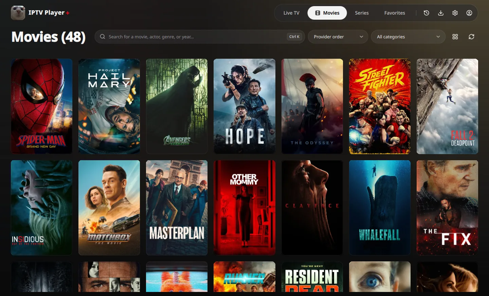
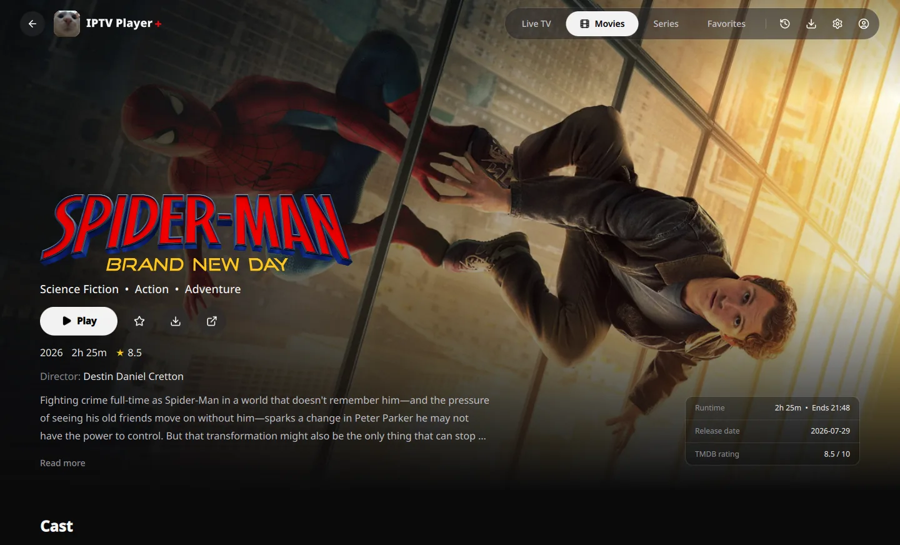
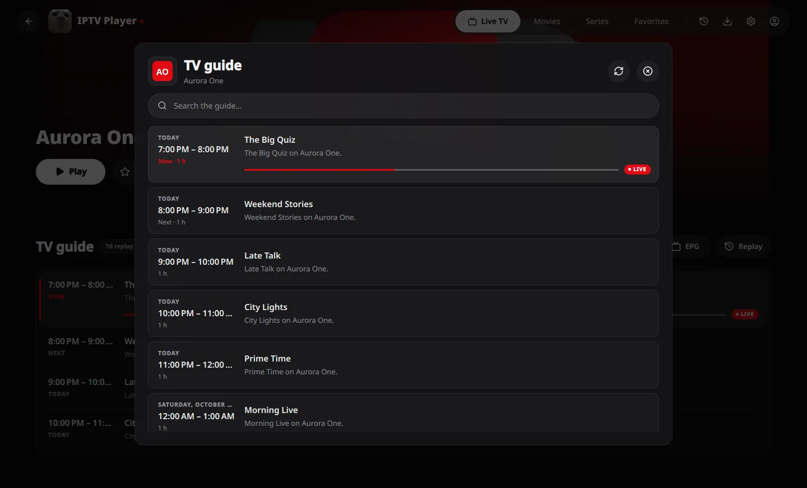

# IPTV Player +

A native desktop player for your Xtream Codes account, on Linux, Windows and
macOS: smooth playback, HDR, passthrough audio, and your favorites, history and
settings on every computer. No account to create: sign in with your provider
and the app does the rest.

- **A real video player**: embedded libmpv with hardware decoding, HDR10 and
  Dolby Vision tone mapping (native HDR in fullscreen on Windows), bitstream
  audio passthrough, picture-in-picture and a 2×2 multi-view of live channels.
- **The whole catalog**: live TV with its guide and replay, movies and series
  with rich artwork, and downloads for offline viewing.
- **A home page** with continue watching, recently added movies and series,
  channels with replay and the week's trends your provider can play.
- **Synced everywhere**: the app creates an anonymous access key for you.
  Copy it from **Settings → Account** and paste it on another computer with
  **Use an existing key**: favorites, watch history, resume points and
  settings stay the same on both. The same key signs you in on the website.
- **Private by design**: the key is sixteen random digits, with no email and no
  account. Your provider address and credentials never leave your computer.
- **Works on its own**: if our service cannot be reached, playback and your
  library keep working, and your changes are synced once it is back.
- **Parental control** with a PIN and a section for kids.

IPTV Player + provides no channel and no content: it plays the Xtream Codes
subscription you already have.

## Detail pages

Backdrops, title logos, cast and trailers from TMDB, with your progress and
favorites one click away.

## Live TV with its guide and replay

See what is on now and next, search the programme, and replay past shows when
your provider offers catch-up.

## Series, season by season

Episode cards with progress and watched marks, next and previous episode
controls, and shuffle on a season or the whole series.

## Download

Every version is on the
[releases page](https://github.com/SunkwiBOT/iptv-player-plus/releases), with the
SHA-256 checksum of each package:

| System | Package |
| --- | --- |
| Linux (Ubuntu 22.04, Debian 12, Fedora or newer, 64-bit) | AppImage, RPM |
| Windows 10 or 11, 64-bit | Installer (`.exe`) |
| macOS on Apple silicon | Disk image (`.dmg`) |

The app is free. Installed copies update themselves from **Settings → Updates**,
after you confirm the download and the installation.

## Third-party components

IPTV Player + is built with Qt, libmpv and FFmpeg. libmpv and FFmpeg are built
under the LGPL; the license texts and the list of components are included in
every package, in its `licenses` folder.

## License

IPTV Player + is free to use. Its source code is not published: this repository
only hosts the releases.
